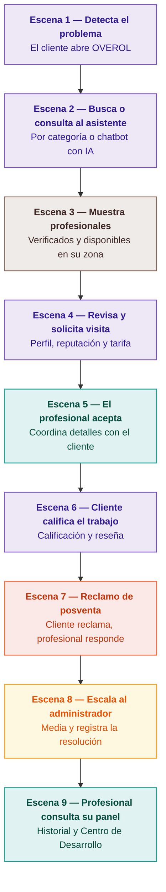

# DUOC UC - Escuela de Informática y Telecomunicaciones

## Propuesta para CAPSTONE

### Proyecto: Overol

* **Revisión:** [001]
* **Fecha:** 20/08/2026
* **Estándares:** Planificación y Especificación de Requisitos según estándares IEEE 830, ISO 9000 y PMI.
* **Equipo de trabajo:** NXBe
* **Compuesto por:** Ximena Campos, Nefi Apablaza, Benjamín Osses
* **Profesor:** Felipe Krauss

---

## Tabla de Contenidos

* [2. Ficha del documento](#2-ficha-del-documento)
* [3. Integrantes](#3-integrantes)
* [4. Visión del proyecto](#4-visión-del-proyecto)
  * [4.1 Breve descripción del proyecto](#41-breve-descripción-del-proyecto)
  * [4.2 Vincular el proyecto al perfil de egreso](#42-vincular-el-proyecto-al-perfil-de-egreso)
  * [4.3 Vincular el proyecto a las aspiraciones personales](#43-vincular-el-proyecto-a-las-aspiraciones-personales)
* [5. Producto Mínimo Viable](#5-producto-mínimo-viable)
  * [5.1 Relato del PMV](#51-relato-del-pmv)
  * [5.2 Story Board del PMV](#52-story-board-del-pmv)
* [6. Épicas](#6-épicas)
  * [6.1 Épica 001 – Registro y verificación de identidad del profesional](#61-épica-001--registro-y-verificación-de-identidad-del-profesional)
  * [6.2 Épica 002 – Búsqueda y categorización de servicios](#62-épica-002--búsqueda-y-categorización-de-servicios)
  * [6.3 Épica 003 – Chatbot para diagnóstico de necesidad](#63-épica-003--chatbot-para-diagnóstico-de-necesidad)
  * [6.4 Épica 004 – Perfil profesional y reserva de visita](#64-épica-004--perfil-profesional-y-reserva-de-visita)
  * [6.5 Épica 005 – Geolocalización y zona de cobertura](#65-épica-005--geolocalización-y-zona-de-cobertura)
  * [6.6 Épica 006 – Sistema de reputación y evaluación](#66-épica-006--sistema-de-reputación-y-evaluación)
  * [6.7 Épica 007 – Centro de Desarrollo Profesional](#67-épica-007--centro-de-desarrollo-profesional)
  * [6.8 Épica 008 – Panel de administración y moderación de la plataforma](#68-épica-008--panel-de-administración-y-moderación-de-la-plataforma)
  * [6.9 Épica 009 – Sistema de posventa y gestión de reclamos](#69-épica-009--sistema-de-posventa-y-gestión-de-reclamos)
* [7. Plan de Trabajo – Sobre Poker Planning](#7-plan-de-trabajo--sobre-poker-planning)
  * [7.1 Dimensionamiento Épicas](#71-dimensionamiento-épicas)
  * [7.2 Distribución en las semanas](#72-distribución-en-las-semanas)

---

## 2. Ficha del documento

| Fecha | Revisión | Autor | Modificación |
| :--- | :--- | :--- | :--- |
| 20/08/2026 | 001 | Equipo Capstone NXBe | Sin modificación |

**Documento validado por las partes en fecha:** 31/12/2026

---

## 3. Integrantes

| Nombre Integrante del Equipo | Rol Definido |
| :--- | :--- |
| Ximena Campos García | Product Owner / Analista De Requisitos |
| Benjamín Osses Venegas | Desarrollador Front-end / UX |
| Nefi Apablaza Olivares | Desarrollador Back-end |

---

## 4. Visión del proyecto

### 4.1 Breve descripción del proyecto
OVEROL es una plataforma digital diseñada para conectar de forma directa a usuarios del hogar con profesionales de oficios calificados con el fin de reparar, arreglar, restaurar, instalar o modificar arreglos en su hogar. El proyecto elimina los intermediarios tradicionales que encarecen el costo final y reducen el margen del trabajador, ofreciendo un acceso 100% gratuito para el cliente y operando mediante un modelo de suscripción mensual para el prestador de servicios. 

Adicionalmente, OVEROL integra un Centro de Desarrollo Profesional que capacita a los trabajadores en formalización tributaria, seguridad laboral y gestión comercial, impulsando la profesionalización, estabilidad y sofisticación del trabajo independiente en la región.

### 4.2 Vincular el proyecto al perfil de egreso
El desarrollo de OVEROL permite aplicar y demostrar las competencias del perfil de egreso de Ingeniería en Informática de DUOC UC, entre ellas:
* El análisis y levantamiento de requerimientos a partir de un problema real del entorno.
* El diseño de la arquitectura de una solución de software completa, incluyendo frontend, backend, modelamiento de base de datos, conexión con APIs e integración con servicios externos de geolocalización, identidad y pagos.
* La aplicación de metodologías ágiles de gestión de proyectos informáticos.
* La incorporación de criterios de usabilidad, seguridad de la información y escalabilidad en el diseño del producto.

El proyecto integra componentes de inteligencia artificial mediante un chatbot conversacional y una arquitectura de marketplace con perfiles de usuario y múltiples integraciones, lo que permite evidenciar competencias de análisis, diseño, desarrollo, implementación y gestión de proyectos propias de un Ingeniero en Informática.

### 4.3 Vincular el proyecto a las aspiraciones personales
Como equipo, nos motiva desarrollar un proyecto de alto impacto social que aborde una problemática tangible en el contexto chileno: la informalidad y la precariedad que afectan a miles de trabajadores independientes de oficio. OVEROL nos permite canalizar nuestra vocación por la ingeniería de software hacia una solución inclusiva que promueve el trabajo justo, la eliminación de intermediarios y la formalización laboral.

A nivel profesional, la plataforma constituye una oportunidad estratégica para integrar nuestras distintas especializaciones técnicas dentro de un entorno de desarrollo real y altamente demandado como lo son las plataformas marketplace:

* **Ximena** aplica su orientación hacia la gestión de proyectos, el modelamiento de bases de datos, la arquitectura del software y la inteligencia artificial, liderando la orquestación del desarrollo, gestión, arquitectura y la implementación del asistente conversacional de la plataforma.
* **Nefi** enfoca su desarrollo en la arquitectura de datos, inteligencia artificial y la ingeniería backend, asegurando la robustez, integridad y alta disponibilidad de la lógica de negocio y los servicios centrales.
* **Benjamín** aporta su perfil full-stack y su enfoque en ciberseguridad, garantizando tanto una experiencia de usuario fluida como la protección de datos y el cumplimiento de estándares de seguridad en la aplicación.

Esta convergencia de roles nos permite proyectarnos como profesionales capaces de concebir, asegurar y escalar productos digitales complejos con propósito social.

---

## 5. Producto Mínimo Viable

### 5.1 Relato del PMV
Un cliente ingresa a OVEROL porque tiene un problema en su hogar (por ejemplo, un problema eléctrico). Navega por categorías (ubicación del problema, zona del hogar y especialidad) o bien describe su problema a un asistente conversacional, el cual le sugiere la especialidad correcta. El sistema muestra los profesionales disponibles en su comuna o zona cercana, cada uno con su perfil verificado: experiencia, certificaciones, calificación promedio, historial de trabajos y tarifa de visita. 

El cliente revisa los perfiles, compara reputación y disponibilidad, y solicita una visita al profesional elegido. El profesional recibe la solicitud, la revisa y decide aceptarla o rechazarla; si la acepta, ambos coordinan directamente fecha, alcance del trabajo y forma de pago, sin intermediación de la plataforma. Tras finalizar el trabajo, el cliente califica al profesional en distintas categorías (calidad, puntualidad, trato) y deja una reseña, y el profesional califica al usuario, lo que actualiza el historial y la reputación de ambos para futuras interacciones. 

Si el cliente o el trabajador no quedan conformes, interviene el administrador como flujo de posventa. En paralelo, el profesional que accedió a la plataforma mediante una suscripción mensual y validó su identidad gestiona su disponibilidad, su zona de cobertura y sus solicitudes, y además puede acceder al Centro de Desarrollo Profesional para capacitarse en formalización tributaria, seguridad laboral y elaboración de presupuestos.

### 5.2 Story Board del PMV
El flujo mínimo viable del producto puede resumirse en las siguientes escenas secuenciales:

* **Escena 1 —** El cliente detecta un problema en su hogar y abre OVEROL.
* **Escena 2 —** Busca por categoría o describe el problema al asistente conversacional.
* **Escena 3 —** La plataforma muestra profesionales verificados disponibles en su zona.
* **Escena 4 —** El cliente revisa perfiles, reputación y tarifa de visita, y solicita una visita.
* **Escena 5 —** El profesional acepta la solicitud y coordina los detalles directamente con el cliente.
* **Escena 6 —** Finalizado el trabajo, el cliente califica al profesional y deja una reseña.
* **Escena 7 —** Si el cliente detecta un problema con el trabajo, abre un reclamo de posventa y el profesional responde con una solución.
* **Escena 8 —** Si no hay acuerdo, el reclamo escala al administrador, quien media y registra la resolución final.
* **Escena 9 —** El profesional consulta su historial, su disponibilidad y el Centro de Desarrollo Profesional.

---

## 6. Épicas

### 6.1 Épica 001 – Registro y verificación de identidad del profesional

#### Definición
> Como profesional de oficio, quiero registrarme en la plataforma validando mi identidad con cédula de identidad, para poder ofrecer mis servicios con un perfil confiable y verificado.

#### Criterios de Aceptación
* El sistema solicita RUT, nombre completo y fotografía de la cédula de identidad al momento del registro.
* El sistema impide la creación de más de un perfil profesional asociado al mismo RUT.
* El profesional recibe una notificación indicando si su verificación fue aprobada o rechazada.

---

### 6.2 Épica 002 – Búsqueda y categorización de servicios

#### Definición
> Como cliente, quiero buscar el servicio que necesito navegando por categorías de ubicación, zona del hogar y especialidad, para encontrar rápidamente al profesional adecuado.

#### Criterios de Aceptación
* El cliente puede seleccionar progresivamente ubicación del problema, zona del hogar y especialidad requerida.
* El sistema muestra únicamente profesionales disponibles que coincidan con la categoría seleccionada.
* El cliente puede modificar los filtros de búsqueda en cualquier momento sin perder el flujo de navegación.
* El cliente puede dirigirse a la barra de búsqueda y escribir palabras clave para encontrar al profesional más rápidamente.

---

### 6.3 Épica 003 – Chatbot para diagnóstico de necesidad

#### Definición
> Como cliente que no sabe qué tipo de profesional necesita, quiero describir mi problema a un asistente conversacional, para que me recomiende la especialidad correcta y me muestre los profesionales disponibles.

#### Criterios de Aceptación
* El cliente puede escribir una descripción libre del problema que presenta.
* El asistente identifica al menos una categoría o especialidad relacionada con la descripción ingresada.
* El sistema redirige automáticamente al cliente hacia el listado de profesionales de la especialidad sugerida.

---

### 6.4 Épica 004 – Perfil profesional y reserva de visita

#### Definición
> Como cliente, quiero visualizar el perfil completo de un profesional, incluyendo experiencia, certificaciones, valoraciones y tarifa de visita, y solicitar una visita, para decidir con información suficiente y coordinar directamente con él.

#### Criterios de Aceptación
* El perfil muestra experiencia, especialidades, certificaciones, historial de trabajos y calificación promedio.
* El cliente puede enviar una solicitud de visita indicando fecha u horario tentativo.
* El profesional puede aceptar o rechazar la solicitud, y el cliente recibe la respuesta mediante notificación.

---

### 6.5 Épica 005 – Geolocalización y zona de cobertura

#### Definición
> Como cliente, quiero ver únicamente profesionales que cubren mi comuna o zona geográfica, para asegurarme de contactar a alguien que efectivamente pueda atender mi solicitud.

#### Criterios de Aceptación
* El profesional puede definir una o varias comunas dentro de su zona de cobertura.
* El sistema filtra los resultados de búsqueda del cliente según su comuna y las zonas declaradas por los profesionales.
* El cliente puede ampliar el radio de búsqueda a comunas cercanas si no encuentra resultados en su zona.

---

### 6.6 Épica 006 – Sistema de reputación y evaluación

#### Definición
> Como cliente, quiero calificar y dejar una reseña sobre el trabajo realizado por un profesional, para ayudar a otros usuarios a tomar mejores decisiones y aportar a la reputación del profesional.

#### Criterios de Aceptación
* El cliente puede calificar el trabajo en categorías como calidad, puntualidad y trato, además de dejar un comentario.
* La calificación solo puede realizarse después de una visita o solicitud confirmada como completada.
* El perfil del profesional actualiza automáticamente su calificación promedio y su historial con cada nueva evaluación.

---

### 6.7 Épica 007 – Centro de Desarrollo Profesional

#### Definición
> Como profesional de oficio, quiero acceder a contenido de capacitación sobre formalización tributaria, seguridad laboral y elaboración de presupuestos, para mejorar la profesionalización y estabilidad de mi actividad.

#### Criterios de Aceptación
* El profesional puede acceder a una sección con videos y guías propios organizados por módulos (tributario, seguridad, gestión).
* El sistema incorpora contenido o enlaces de terceros oficiales, como el SII y mutuales de seguridad, dentro del módulo correspondiente.
* El profesional puede marcar contenidos como vistos o completados dentro de su perfil.

---

### 6.8 Épica 008 – Panel de administración y moderación de la plataforma

#### Definición
> Como administrador de OVEROL, quiero contar con un panel centralizado para verificar la identidad y certificaciones de los profesionales, moderar reseñas y gestionar el contenido de la plataforma, para asegurar la confianza, calidad y buen funcionamiento del marketplace.

#### Criterios de Aceptación
* El administrador puede revisar, aprobar o rechazar las solicitudes de verificación de identidad y certificaciones enviadas por los profesionales.
* El administrador puede visualizar, suspender o eliminar perfiles de clientes o profesionales que infrinjan las normas de la plataforma, así como moderar reseñas reportadas.
* El administrador puede gestionar el contenido publicado en el Centro de Desarrollo Profesional (videos, guías) y los banners publicitarios de retailers.

---

### 6.9 Épica 009 – Sistema de posventa y gestión de reclamos

#### Definición
> Como cliente, quiero poder reportar un problema con el trabajo realizado dentro de un plazo determinado después de finalizado el servicio, para solicitar una solución, corrección o garantía al profesional que lo ejecutó.

#### Criterios de Aceptación
* El cliente puede abrir un reclamo de posventa dentro de un plazo definido (por ejemplo, 7 días corridos) desde que el trabajo fue marcado como completado.
* El profesional recibe la notificación del reclamo y debe responder indicando cómo lo resolverá, o justificando su postura, dentro de un plazo acotado.
* Si no hay acuerdo entre cliente y profesional, el reclamo escala automáticamente al administrador para mediar, y la resolución final queda registrada en el historial del profesional.

---

## 7. Plan de Trabajo – Sobre Poker Planning

### 7.1 Dimensionamiento Épicas

| Épica | Tamaño en PF |
| :--- | :---: |
| Épica 001 – Registro y verificación de identidad del profesional | 10 |
| Épica 002 – Búsqueda y categorización de servicios | 5 |
| Épica 003 – Asistente inteligente para diagnóstico de necesidad | 10 |
| Épica 004 – Perfil profesional y reserva de visita | 5 |
| Épica 005 – Geolocalización y zona de cobertura | 8 |
| Épica 006 – Sistema de reputación y evaluación | 3 |
| Épica 007 – Centro de Desarrollo Profesional | 1 |
| Épica 008 – Panel de administración y moderación de la plataforma | 15 |
| Épica 009 – Sistema de posventa y gestión de reclamos | 5 |

### 7.2 Distribución en las semanas

| Épica | Sem 5 | Sem 6 | Sem 7 | Sem 8 | Sem 9 | Sem 10 | Sem 11 | Sem 12 | Sem 13 | Sem 14 |
| :--- | :---: | :---: | :---: | :---: | :---: | :---: | :---: | :---: | :---: | :---: |
| Épica 001 – Registro y verificación de identidad | **X** | | | | | | | | | |
| Épica 002 – Búsqueda y categorización de servicios | **X** | **X** | | | | | | | | |
| Épica 003 – Asistente inteligente (IA) | | | **X** | **X** | | | | | | |
| Épica 004 – Perfil profesional y reserva de visita | | **X** | **X** | | | | | | | |
| Épica 005 – Geolocalización y zona de cobertura | | | | | **X** | **X** | | | | |
| Épica 006 – Sistema de reputación y evaluación | | | | | | | **X** | | | |
| Épica 007 – Centro de Desarrollo Profesional | | | | | | | | **X** | | |
| Épica 008 – Panel de administración y moderación | | | | | | | **X** | **X** | | |
| Épica 009 – Sistema de posventa y gestión de reclamos | | | | | | | | | **X** | **X** |